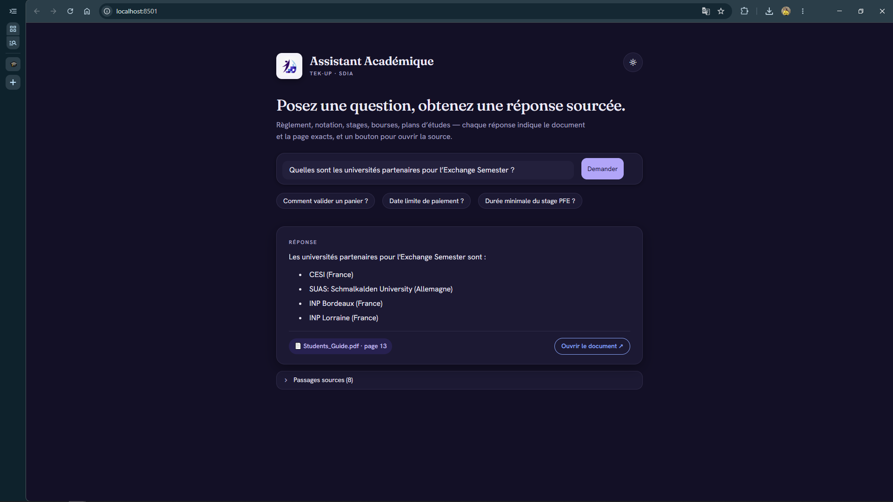
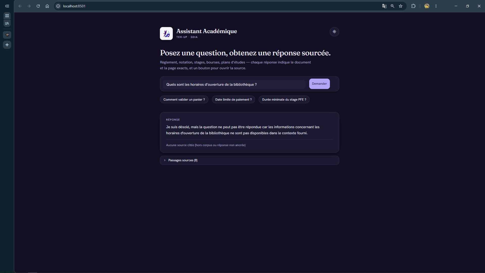
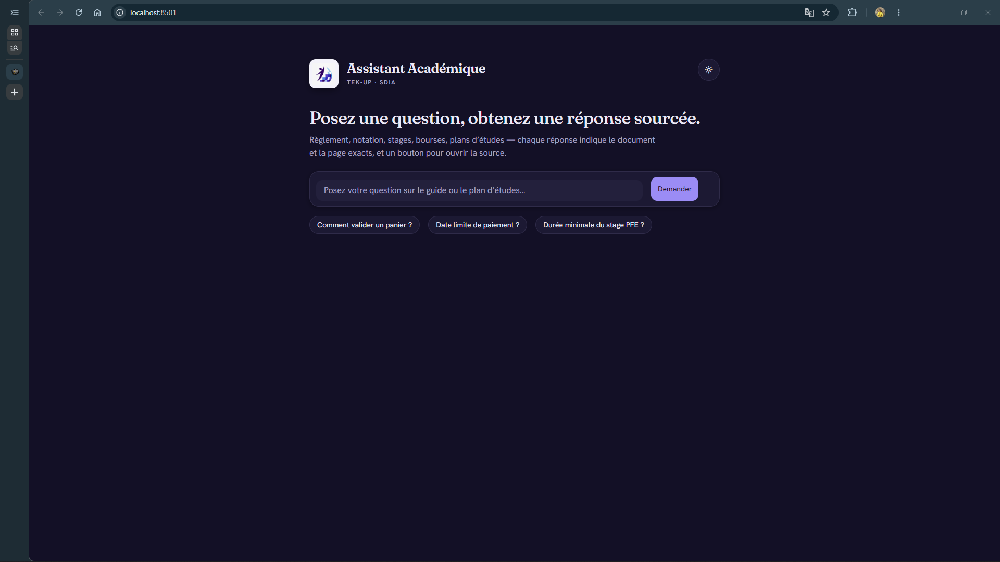
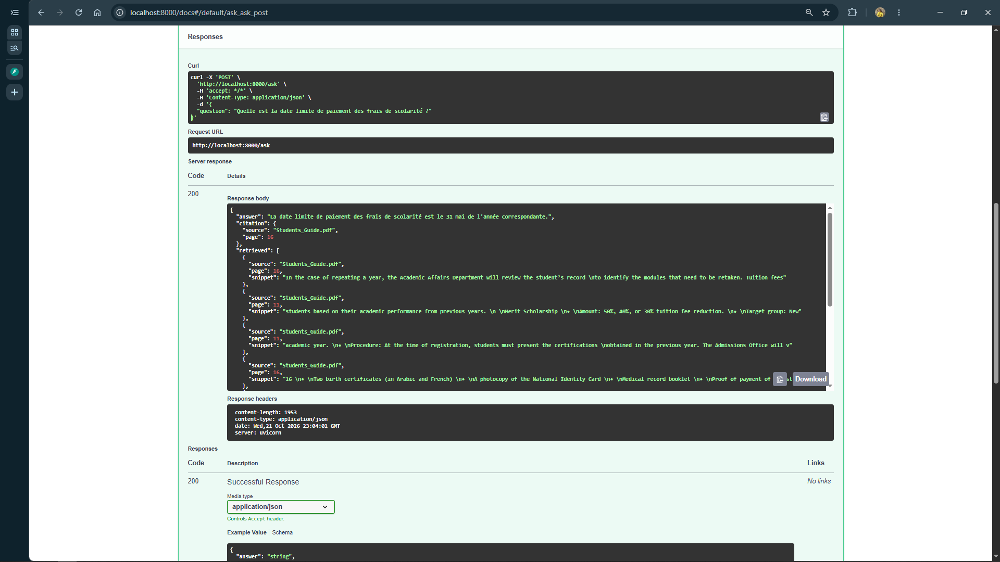
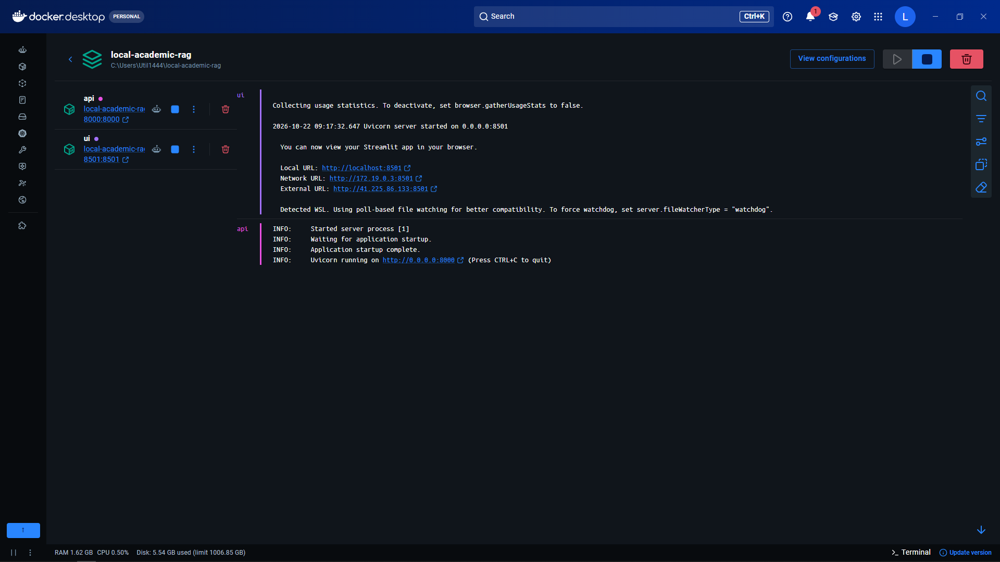
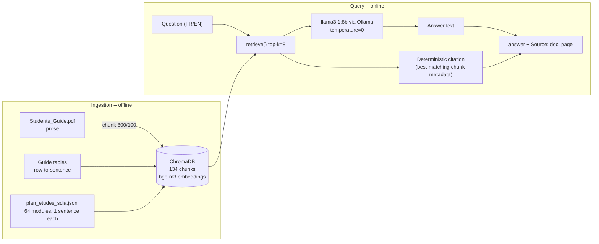

<!--
  BEFORE YOU PUBLISH — a few placeholders left:
   • ▶ Watch the demo  → paste your video link (YouTube unlisted / Drive)
   • docs/screenshots/ → drop the 5 PNGs there with the names used below
   • CI badge          → uncomment once GitHub Actions is set up
-->

# Local Academic RAG — TEK-UP Student Advisor

> A **local** Retrieval-Augmented Generation assistant that answers students'
> academic questions by **citing the exact document and page**, and **refuses when
> the answer is not in the sources** — so it never makes facts up.


-orange)


<!--  -->

---

## What it is

An AI advisor for the **SDIA** engineering track at **TEK-UP University**. A student
asks a question in natural language (FR or EN) about the curriculum, grading rules,
internships, scholarships or exchange programs, and the assistant answers **only from
the official documents**, always showing **which document and page** the answer comes
from.

### Why this one is different

Most student RAG projects are a thin wrapper around an LLM. This one adds the three
things that make a retrieval system trustworthy:

- **Verifiable, unforgeable citations** — the source is read from the retrieved
  chunk's **metadata**, never written by the model. The LLM cannot invent a page.
- **Anti-hallucination by design** — out-of-corpus questions are **refused** with no
  source, instead of being answered with a plausible guess.
- **A real evaluation harness** — three independent metrics, a documented test set,
  a model comparison, and even **documented negative results**. Choices are *measured*,
  not asserted.

---

## Demo

▶ **[Watch the demo](https://drive.google.com/file/d/1Ydc4l3ArmpSW69K6M3beyvhn8-e0v8us/view?usp=sharing)**

**Answering with a verifiable citation** — the answer, the exact source + page, and a
button to open the document:



**Refusing when the answer isn't in the sources** (anti-hallucination) — no source shown:



**The interface** (light & dark themes, bilingual FR/EN):



**Structured API response** — the citation is part of the JSON, read from metadata,
never generated by the model:



**Fully containerized** — `docker compose up` runs the API and the UI:



---

## Architecture



Two design decisions carry the project:

1. **`retrieve()` and `answer()` are separated.** Retrieval does *not* call the LLM, so
   search quality and generation quality are **measured independently**. This is what
   lets the evaluation say *where* a problem is, not just that one exists.
2. **The citation is metadata, not text.** After the model answers, we pick the
   retrieved chunk whose content best matches the answer (rarity-weighted token
   overlap) and read its `source` + `page` from metadata. The model never produces the
   citation, so it **cannot forge it**.

---

## Tech stack

| Layer | Choice |
|---|---|
| RAG framework | **LangChain** |
| Vector store | **ChromaDB** |
| Embeddings | **bge-m3** (via Ollama) |
| LLM | **llama3.1:8b** (via Ollama) |
| Model server | **Ollama** |
| API | **FastAPI** + Uvicorn |
| UI | **Streamlit** |
| Config | **pydantic-settings** |
| Packaging | **Docker Compose** |

---

## How it works

### Corpus & ingestion

Two sources feed **one** vector store (134 chunks total):

- **Study plan** (`plan_etudes_sdia.jsonl`) — 64 modules, pre-processed into one
  self-contained sentence + metadata per module. Consumed **as-is**.
- **Student guide** (`Students_Guide.pdf`) — prose is chunked (800 chars / 100
  overlap); **tables are turned into one sentence per row** (row-to-sentence), which
  makes precise table facts (an e-mail, a grade band) directly retrievable.

Pages with fewer than 50 characters (image-only cover) are skipped.

### Deterministic citation (the core feature)

The citation points to the chunk that actually **contains** the answer — not the
top-ranked chunk. Concrete example from the test set:

> **Q: "What is the incubator's e-mail?"**
> The rank-1 retrieved chunk was a *contacts table on page 19* (wrong page). The answer
> (`incubator@tek-up.de`) lives in a prose chunk on **page 10**. The system cites
> **page 10**, because it matches the citation to the chunk that contains the answer.

Rarity weighting makes a distinctive token (`incubator`, in a single chunk) outweigh
common ones (`email`, `tek`, in many chunks). On a refusal, no citation is shown.

### Anti-hallucination

Out-of-corpus questions (e.g. "library opening hours", a specialty that doesn't exist)
trigger a **refusal** with **no source**. Measured: **3/3** on the trap questions, with
**zero** fabricated citations.

---

## Evaluation & Benchmarking

Choices in this project are **measured**. The harness (`eval/run_eval.py`) runs a
hand-built test set of **19 pinpoint questions + 3 list questions** (ground truth
verified against the source documents) and scores several **independent** axes.

### Headline results (llama3.1:8b, top-k = 8)

| Axis | Score | What it measures |
|---|:---:|---|
| **Retrieval** (page-level) | **16/16** | Correct page is among the retrieved chunks (no LLM involved). |
| **Generation** | **19/19** | Expected value present in the answer, or correct refusal. |
| **Citation accuracy** | **15/16** | Cited `(document, page)` exactly matches the expected one. |
| **Refusal without citation** | **3/3** | Out-of-corpus questions refused, no source shown. |

> *Why 16 and not 19 for retrieval/citation:* the 3 trap questions have no "correct
> page", so they are out of that count.
>
> *The one citation miss* (a short French answer over an English source with no shared
> token) **abstains** rather than cite the wrong page — a deliberate safety choice.

### Model comparison (same prompt, same test set)

| Model | Generation | Notes |
|---|:---:|---|
| llama3.2:3b | 17/19 | 2 anti-hallucination errors (wrong e-mail, wrong grade band). |
| **llama3.1:8b** | **19/19** | **Selected** — fixes both errors. |

Retrieval was already 16/16 for both models, so the deciding factor was **model
capacity**, not retrieval or prompt — confirmed by two aggressive tuning attempts that
both regressed (see *Negative results*).

### List questions & the `TOP_K` sweep

"List all X" questions (all partner universities, all modules of a basket) were
under-answered. A **coverage** metric was added (how many of the expected items appear
in the retrieved chunks vs in the answer), then `top-k` was swept:

| Question | k=4 | k=8 |
|---|:---:|:---:|
| Exchange partner universities (4) | 3/4 | **4/4** |
| "Développement" basket modules, S7 (4) | 0/4 | **4/4** |
| "Sciences fondamentales-2" modules (3) | 1/3 | 2/3 |
| **Total coverage** | **4/11** | **10/11** |

Two measured conclusions:

1. **`answer_coverage == retrieval_coverage` in every case** → the bottleneck is
   **retrieval**, not the model. The LLM is *faithful*: it only states what it is given,
   it does not invent. (A strong anti-hallucination result.)
2. **`top-k = 8` raises coverage 4/11 → 10/11 with zero regression** on the 19 pinpoint
   questions → adopted as the default. The remaining miss is a *ranking* issue
   (the embedder confuses similarly-named baskets), not a volume issue — a metadata
   filter would fix it (see *Future work*).

---

## Documented negative results

Approaches that were tried, **measured**, and **reverted** — kept here because a
negative result is still a result, and knowing *why* something fails is engineering.

| Attempt | Hypothesis | Measured outcome | Decision |
|---|---|---|---|
| **MMR retrieval** | Diversify context to fix a miss | 17 → 15/19; ejected complementary chunks | Reverted |
| **Hardened prompt** | Stricter rules reduce errors | 17 → 15/19; made answers terse | Reverted |
| **Semantic citation fallback** | Embedding similarity when lexical overlap = 0 | Cited the *wrong* page (cosines of same-topic chunks don't separate) | Reverted |

---

## Getting started

### Prerequisites

- [Ollama](https://ollama.com) installed and running
- The two models pulled:
  ```bash
  ollama pull llama3.1:8b
  ollama pull bge-m3
  ```
- Python 3.12+

### Run locally

```bash
# 1. Clone
git clone https://github.com/Lobna08/Local-Academic-RAG.git
cd Local-Academic-RAG

# 2. Install
python -m venv venv && source venv/bin/activate   # Windows: venv\Scripts\activate
pip install -r requirements.txt

# 3. Build the vector index (one time)
python scripts/build_index.py

# 4. Start the API
uvicorn src.api:app --port 8000
#    …and the UI in another terminal
streamlit run ui/app.py
```

Open the UI at `http://localhost:8501`, or the API docs at `http://localhost:8000/docs`.

### Run with Docker

The API and UI are containerized; **Ollama stays on the host** (no model duplication),
and the existing Chroma index is **mounted** as a volume.

```bash
# Make the host Ollama reachable from containers, then:
docker compose up
```

- API → `http://localhost:8000`  ·  UI → `http://localhost:8501`

---

## Project structure

```
Local-Academic-RAG/
├── src/
│   ├── config.py          # pydantic-settings; all tunables, env-overridable
│   ├── ingest.py          # JSONL + PDF prose + table row-to-sentence
│   ├── vectorstore.py     # ChromaDB build / load, bge-m3 embeddings
│   ├── rag.py             # retrieve() / answer() + deterministic citation
│   └── api.py             # FastAPI: POST /ask, GET /health
├── ui/
│   ├── app.py             # Streamlit client of the API
│   └── assets/            # TEK-UP logo
├── eval/
│   ├── run_eval.py        # 3-metric harness + list coverage
│   └── eval_set.csv       # 22 test cases with ground truth
├── scripts/
│   └── build_index.py     # one-off index builder
├── data/                  # source documents (jsonl + pdf)
├── docs/screenshots/      # README images
├── Dockerfile
├── docker-compose.yml
├── .env.example
└── requirements.txt       # pinned versions
```

---

## Limitations & future work

Known boundaries — documented on purpose.

- **Cross-language citations.** A short French answer over an English source with no
  shared surface token gets no citation (it abstains rather than cite wrong). A tested
  embedding fallback made it *worse*, so it was reverted. *Future work:* a harder eval
  set, then re-evaluate.
- **List-question ranking.** At `top-k = 8` some basket-module lists are still
  incomplete because the embedder confuses similarly-named baskets. *Future work:*
  structured retrieval / a `panier_code` metadata filter.
- **Embedder not formally benchmarked.** bge-m3 was chosen on reputation; retrieval is
  already saturated (16/16), so it is not the binding constraint. The method to compare
  embedders (swap + `--retrieval-only`) is ready if needed.

---

## Author

**Lobna Ahmed**

## License

Released under the MIT License — see [`LICENSE`](LICENSE).
